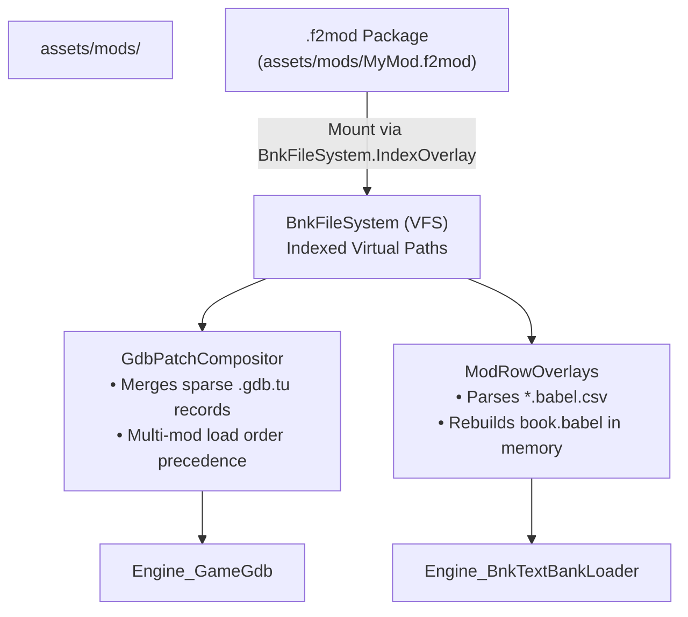

# Refii Native Mod Container (`.f2mod`) Specification & Guide

This document details the binary specification, Virtual File System (VFS) integration, incremental sync engine, and editor tooling for Refii's native `.f2mod` package format.

---

## 1. Overview & Architectural Goals

The `.f2mod` file container is Refii's native mod packaging and distribution format. It is designed specifically to meet the high-performance requirements of a recompiled host engine:

1. **Zero-Unpacking Direct VFS Mounting**:
   - The game engine mounts `.f2mod` files directly via seek/slice offsets.
   - **No temporary files or extraction to disk**: Asset bytes are read on demand from the archive using raw file offsets.
2. **Sub-5ms Append-Only Incremental Sync**:
   - In-editor modifications (GDB stats, localized text, items) update multi-gigabyte `.f2mod` packages in under 5 milliseconds.
   - Total disk I/O is proportional *only* to the size of modified files, regardless of overall archive size.
3. **Drop-and-Play Distribution**:
   - Players install mods by placing `<ModName>.f2mod` directly into `assets/mods/`.
   - Eliminates complex installation scripts, extraction tools, or loose directory management for users.

---

## 2. Binary Layout Specification

An `.f2mod` file consists of four main sections:

```
+-------------------------------------------------------+
|  Header (32 Bytes)                                    |
+-------------------------------------------------------+
|  Metadata Block (Embedded mod.toml in UTF-8)         |
+-------------------------------------------------------+
|  Payload Area (16-Byte Aligned Data Slices)          |
|  • files/weapons/sword.gdb.tu                         |
|  • files/language/en-uk/text/book.babel.csv           |
|  • files/art/...                                      |
+-------------------------------------------------------+
|  Index Table (Located at IndexOffset)                 |
|  • EntryCount (uint32)                                |
|  • Array of F2ModEntry structs                        |
+-------------------------------------------------------+
```

### 2.1. Header Structure (32 Bytes)
All integer scalars are stored in **little-endian** byte order:

| Offset | Type | Field Name | Description |
| :--- | :--- | :--- | :--- |
| `0x00..0x03` | `uint32` | `Magic` | ASCII `'F2MD'` (`0x444D3246`) |
| `0x04..0x07` | `uint32` | `Version` | Container format version (currently `1`) |
| `0x08..0x0B` | `uint32` | `Flags` | Container flags (reserved, default `0`) |
| `0x0C..0x13` | `uint64` | `MetadataOffset` | File offset to embedded metadata block |
| `0x14..0x17` | `uint32` | `MetadataLength` | Byte length of metadata block |
| `0x18..0x1F` | `uint64` | `IndexOffset` | File offset to trailing index table |

### 2.2. Metadata Block
- Located at `MetadataOffset`.
- Contains raw UTF-8 text of the mod's `mod.toml` metadata (title, author, version, description, dependencies).
- The Launcher reads metadata in ~10 microseconds by reading the 32-byte header and seeking directly to `MetadataOffset`.

### 2.3. Payload Area
- Contains the uncompressed raw binary payloads of all assets stored within the mod.
- Each entry payload is **aligned to 16-byte boundaries** to support fast direct seek and memory-mapped reads.

### 2.4. Index Table Structure
Located at `IndexOffset` (at the end of the payload section):

1. **`EntryCount`** (`uint32`): Number of entries in the index.
2. **Entries Array** (`EntryCount` items):
   - **`PathLength`** (`uint16`): Length of normalized UTF-8 relative path string.
   - **`Path`** (`UTF-8` bytes): Forward-slash normalized relative path (e.g. `language/en-uk/text/book.babel.csv`).
   - **`Offset`** (`uint64`): Absolute file offset to the 16-byte aligned payload.
   - **`Size`** (`uint64`): Byte size of the payload.
   - **`ModTimeUtc`** (`int64`): UTC timestamp ticks of last modification.
   - **`Flags`** (`uint32`): Entry flags (reserved, default `0`).

---

## 3. Append-Only Incremental Sync Engine

When an author or the Godot Editor updates a mod, `Refii.Mods.F2ModPackage.IncrementalSync(...)` performs an append-only update:

```
Existing Archive:  [ Header ][ Metadata ][ Payload A ][ Payload B ][ Old Index Table ]
                                                                        │
Incremental Sync: [ Header ][ Metadata ][ Payload A ][ Payload B ][ New Payload C ][ New Index Table ]
```

### 3.1. Sync Operations

1. **New Data (File Added)**:
   - Seeks to the current `IndexOffset` (overwriting the old trailing index table).
   - Aligns stream to 16 bytes and appends the new file payload.
   - Adds a new entry to the in-memory index table dictionary.
2. **Edited Data (File Modified)**:
   - Appends the modified file's new payload at the current append point.
   - Updates the entry in the in-memory index table with the new `Offset`, `Size`, and `ModTimeUtc`.
3. **Deleted Data (File Removed)**:
   - Simply omits the deleted entry from the new index table! Old payload bytes remain abandoned in the file body until an optional defragmentation repack.
4. **Finalization**:
   - Writes the new Index Table directly following the last appended payload.
   - Updates `MetadataOffset` and `IndexOffset` in the 32-byte header at `0x00`.
   - Truncates any obsolete trailing bytes using `SetLength()`.

### 3.2. Performance Characteristics
- **Execution Time**: $< 5\text{ ms}$ regardless of whether the mod package is 10 MB or 10 GB.
- **Disk I/O**: Proportional strictly to the bytes of newly added/edited files plus the index table (~a few KB).

---

## 4. VFS Mounting & Runtime Pipeline



### 4.1. Direct VFS Mounting (`BnkFileSystem.IndexOverlay`)
- At startup or when overlays reload, `BnkFileSystem` mounts `.f2mod` files.
- Opens the package stream with `FileShare.ReadWrite` to allow concurrent editor writes.
- Reads the index table and registers virtual files into the VFS tree.
- When an asset is requested (by Godot host systems or the native guest engine), `BnkFile` reads the exact slice `[Offset, Offset + Size)` directly from the open package stream.

### 4.2. Path Normalization & Aliasing Rules
1. **`files/` Prefix Stripping**:
   - Entries stored as `files/language/en-uk/text/book.babel.csv` or `language/en-uk/text/book.babel.csv` automatically resolve to `language/en-uk/text/book.babel.csv`.
2. **Bidirectional Aliasing**:
   - `BnkFileSystem.AliasesFor(...)` handles bidirectional alias resolution between `data/...` prefixes and culture folders (`language/en-uk/text/...` $\leftrightarrow$ `language/text/...`).

---

## 5. Mod Asset Overrides & Preferred Mechanics

### 5.1. Game Database Title Updates (`.gdb.tu`) — PREFERRED
> [!IMPORTANT]
> **Preferred Asset Replacement Mechanism**: Raw direct file replacements (like loose `.tex.png` or `.mdl.glb` overlays) are deprecated. For models, textures, items, weapons, clothing, and entities, mods should modify `.gdb.tu` sparse database records to point to asset paths/hashes or alter properties.

- **Sparse Title Updates**: A `.gdb.tu` targets a base game database (e.g. `weapons/sword.gdb.tu`).
- **Composite Merging**: `GdbPatchCompositor.Apply` merges sparse `.gdb.tu` files across all enabled mods in load order. If two mods touch different properties of the same record, both edits apply; if they touch the same property, the higher-priority mod in `loadorder.toml` wins.

### 5.2. Localized Text Overlays (`book.babel.csv`)
- Localized string overlays ship as `language/en-uk/text/book.babel.csv` inside `.f2mod` packages.
- `ModRowOverlays.Apply` parses the CSV rows directly from the `.f2mod` stream, patches the base binary `book.babel` in memory, registers the updated table in VFS, and invalidates `Engine_BnkTextBankLoader`.

---

## 6. Directory Layout & Creator Workbench Conventions

```text
assets/
├── mods/                               # Production Drop & Play Directory
│   ├── loadorder.toml                  # Load order and enabled list
│   ├── MikiBalancePatch.f2mod          # Single-file mod package
│   └── AlbionOverhaul.f2mod            # Single-file mod package
│
└── creators/                           # Creator Workbench (Excluded from game VFS)
    └── MikiBalancePatch/
        ├── raw_models/                 # Blender / FBX source files
        ├── raw_textures/               # PSD / Substance project files
        └── notes/                      # Development notes and drafts
```

- **`assets/mods/`**: Contains ONLY `.f2mod` files and `loadorder.toml`. No loose folders.
- **`assets/creators/`**: Workbench directory for mod authors to store raw DCC assets, project source files, and authoring drafts.

---

## 7. Editor Hot-Reloading Pipeline

When an author modifies a database record or string in the Godot Editor (`addons/bnk_mount/`):

1. **`EditorModValueService.SaveItemOverrides(...)`**:
   - Serializes updated `.gdb.tu` databases and `book.babel.csv` files.
   - Invokes `F2ModPackage.IncrementalSync(...)` targeting `assets/mods/<ActiveMod>.f2mod`.
2. **Instant Hot-Reload**:
   - Calls `BnkMountPlugin.Instance?.ReloadModOverlays()`.
   - Invalidates `Engine_GameGdb`, `Engine_BnkTextBankLoader`, `Engine_WeaponIndex`, `Engine_ItemIndex`, `Engine_ClothingIndex`, and viewport scene nodes.
   - The editor viewport and runtime reflect the updated mod values instantly without restarting.
