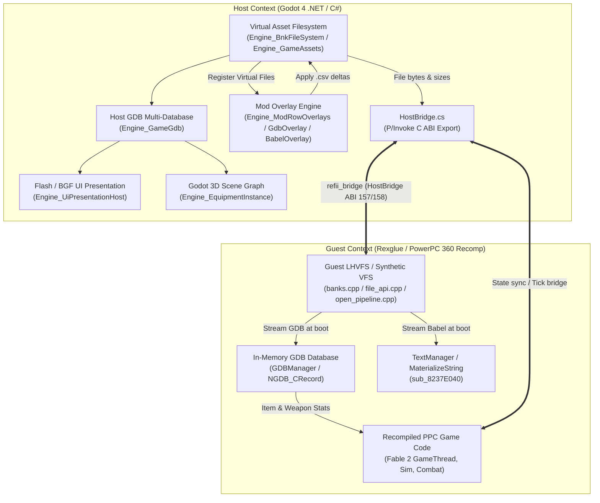

# Fable 2 PC Recomp — Modding Overlay Architecture & Analysis

This document provides a top-down architectural reference of the asset loading, VFS interception, and runtime modding overlay systems in the Refii project (Fable 2 Xbox 360 PC recomp using Rexglue and Godot 4). It explains how original bank files are read, how the overlay system intercepts assets, how the recent Lua overhaul interacts with the pipeline, and provides an in-depth root-cause analysis of current modding defects along with targeted solutions.

---

## 1. High-Level Architecture Overview

Refii operates as a hybrid engine composed of two distinct execution contexts running concurrently:



1. **The Host Context (Godot 4 C#)**:
   - Manages windowing, Vulkan rendering, high-level UI presentation (Flash SWF / BGF documents), equipment scene nodes, asset indexing, and editor tooling (`addons/bnk_mount`).
   - Mounts original Xbox 360 `.bnk` archives into memory via `Engine_BnkFileSystem`.
   - Evaluates mod directories (`mods/<mod_name>/files/`), compiling `.gdb.csv` and `.babel.csv` row overlays dynamically into in-memory virtual `.gdb` and `.babel` blobs.

2. **The Guest Context (PowerPC 360 Recompilation via Rexglue)**:
   - Executes recompiled Xbox 360 game logic (simulations, AI, physics, inventory management, player combat, animation rigs) within an emulated 32-bit big-endian PowerPC virtual memory space (0x40000000–0x70000000).
   - Interacts with files through hooked game subsystems (`LHVFS`, `CBankFile`, `CreateFileA`, `ReadFile`).

3. **The Interop Bridge (`HostBridge.cs` $\longleftrightarrow$ `host_bridge.cpp`)**:
   - Transfers function pointers across native boundaries so the native guest VFS can query Godot's asset filesystem (`refii_bridge_host_asset_size`, `refii_bridge_read_host_asset`, `refii_bridge_host_asset_is_override`, and `refii_bridge_host_name_for_hash`).

---

## 2. Bank File Subsystem: Runtime Reading Pipeline

Fable 2 assets originally reside in monolithic `.bnk` archives (e.g., `globals.bnk`, `data.bnk`, `language/en-uk/text.bnk`).

### 2.1 How Godot Reads Bank Files
1. **Mounting Archives**:
   - `BnkFileSystem` (`Godot/src/Engine/bnk/Engine_BnkFileSystem.cs`) parses the header, directory table, and compressed chunk entries of each `.bnk`.
   - Every file within the archive is registered as a `BnkFile` with an associated `BnkEntry` pointing to its relative path (e.g., `globals/globals.gdb`, `language/en-uk/text/book.babel`).
2. **Path Normalization and Aliasing**:
   - Shipped archives have inconsistent path conventions: some files omit `data/`, while the runtime expects `data/`.
   - `BnkFileSystem.AliasesFor(normalized)` computes bidirectional variations:
     - Strips and adds `data/`.
     - Normalizes culture folder spellings (e.g., `language/en-uk/text/book.babel` $\longleftrightarrow$ `language/text/book.babel`).
3. **Primary Asset Facade**:
   - `Engine_GameAssets` wraps `BnkFileSystem`. Host systems (such as `Engine_GameGdb` and `Engine_UiPresentationHost`) read raw binary bytes from `Engine_GameAssets.Instance.ReadAllBytes(path)`.

### 2.2 How the Guest Recomp Reads Bank Entries
When recompiled PPC game code opens an asset:
1. **Bank Stream Hooks**:
   - Calls to `Bank_OpenStreamByIndex`, `Bank_DirIter_FindStreamByIndex`, and `Bank_FindStreamByHash` are intercepted in `src/vfs/src/hooks/banks.cpp`.
2. **Bridge Invocation**:
   - The hook forwards the request to `TryOpenRefiiBankEntryAsset(...)` in `src/vfs/src/index/open_pipeline.cpp`.
   - Native VFS invokes `HostAssetSize(request.entry_name, entry_size)`:
     ```cpp
     // open_pipeline.cpp lines 681-688
     uint32_t entry_size = 0;
     const bool resolved = HostAssetSize(request.entry_name, entry_size);
     if (resolved) {
       candidate = std::string(request.entry_name);
       resolution.normalized_key = candidate;
       resolution.provider_relative_path = candidate;
       resolution.host_served = true;
     }
     ```
3. **Payload Streaming**:
   - If `HostAssetSize` returns true, `CreateRefiiHostMemoryStream` allocates a guest `DiskStream` structure and invokes `ReadHostAsset(resolution.normalized_key, record->bytes)`.
   - `ReadHostAsset` calls across the C ABI bridge into Godot's `HostBridge.ReadAssetForGuest`, which extracts the bytes from `Engine_GameAssets.Instance.ReadAllBytes(...)`.

---

## 3. The Modding Overlay Interception System

Rather than modifying large `.gdb` or `.babel` binary files directly on disk, the project uses a non-destructive runtime delta overlay pipeline.

### 3.1 Editor Authoring Flow (`EditorModValueService.cs`)
1. **Property Discovery**:
   - When an item (weapon, clothing, consumable) is opened in `ModItemEditorDialog`:
   - `EditorModValueService.DiscoverProperties` scans the item's starting GDB components (`WeaponComponent`, `FirearmComponent`, `InventoryItemComponent`, etc.).
   - It reads schema fields (e.g., `DamageMultiplier`, `BulletCapacity`, `BasePrice`) from `Engine_GameGdb.Database`.
2. **Writing CSV Overlays**:
   - User modifications are serialized to CSV tables in the active mod's folder (`mods/<mod_name>/files/`):
     - GDB properties $\rightarrow$ `<database_path>.csv` (e.g. `globals/globals.gdb.csv` or `entity/entity.gdb.csv`).
     - Formatted as: `entry,property,value` (e.g. `0x12345678,BulletCapacity,6`).
     - Babel strings $\rightarrow$ `language/en-uk/text/book.babel.csv`.
     - Formatted as: `key,value` (e.g. `TEXT_ITEM_WEAPON_SWORD,Excalibur`).

### 3.2 In-Memory Delta Application (`Engine_ModRowOverlays.cs`)
1. **Table Aggregation**:
   - When mods are mounted or reloaded, `Engine_ModRowOverlays.Apply` scans all active mods in load order and aggregates rows per target table.
2. **GDB Patching (`GdbOverlay.Apply`)**:
   - Clones the base binary `.gdb` bytes from `BnkFileSystem`.
   - For each CSV row, looks up the record entry and calls `view.TryFindValueSlot(...)` to locate the binary offset of the 32-bit property.
   - Patches the 4-byte slot in-place (`WriteU32(patched, slot, raw)`).
   - *Design invariant*: `GdbOverlay` deliberately never resizes records or reallocates tables to avoid corrupting internal offsets.
3. **Babel Patching (`BabelOverlay.Apply`)**:
   - Parses the original `book.babel` binary container (`Engine_BabelDatabase`).
   - Merges string overrides into a dictionary keyed by the tag hash (`Fnv1` or parsed hex).
   - Reconstructs and recompiles a brand new binary `book.babel` container via `Engine_BabelWriter.Write`.
4. **Virtual File Injection**:
   - The resulting patched byte buffers are registered into Godot's `BnkFileSystem`:
     ```csharp
     mounted.AddVirtualFile(table, $"<rows:{table}>", bytes.LongLength, () => bytes, owner);
     ```
   - This marks the file with `IsOverride = true` and `SourceArchivePath = "<rows:...>"`.
   - Any query for `globals/globals.gdb` or `language/en-uk/text/book.babel` via `Engine_GameAssets` now returns the patched buffer.

---

## 4. Impact of the Major Lua Overhaul

The recent merge of the `lua` branch replaced the legacy 215k-line decompiler and external override hooks with an integrated runtime compilation pipeline:

1. **Byte-for-Byte Recompilation Oracle**:
   - Bundles Lua 5.1.2 with Lionhead's `continue` extension and vararg compat switch under `refii::luac32`.
   - Shipped scripts in `gamescripts`, `gamescripts_r`, and `guiscripts` decompile and recompile cleanly byte-for-byte.
2. **Removal of Standalone Lua Overrides**:
   - The dedicated Lua override channel was deleted; `lua_use_mod_overrides` now defaults to `false`.
   - Modded scripts now ship directly as text at their virtual path (e.g., `scripts/my_script.lua`) within the mod's asset directory.
   - The standard `BnkFileSystem` overlay automatically intercepts and serves these scripts when the guest executes `TryOpenRefiiBankEntryAsset`.
3. **Relevance to Weapon / Stat Modding**:
   - In Fable 2, certain game mechanics (such as weapon drawing, sheath positions, ammo consumption, and augment activations) are executed or modulated by scripts in `gamescripts`.
   - Because modded Lua scripts now seamlessly mount into the bank overlay, script-level overrides can coexist with GDB row overlays without secondary redirection layers.

---

## 5. Root-Cause Analysis of Current Modding Bugs

Here is the exact technical breakdown of why each symptom is occurring in the current build:

### 5.1 Symptom A: Modified Ammo Capacity Applies to All Flintlock Weapons
- **Observation**: Changing ammo capacity on a specific flintlock pistol causes all other flintlock weapons to inherit that ammo capacity.
- **Root Cause**:
  1. In Fable 2's GDB object schema, items use prototype inheritance (`HashParent = 0x8BE3CD3B`). Individual weapon instances inherit from generic archetypes (e.g., `HeroWeaponFlintlockPistol` $\rightarrow$ `BaseFlintlockPistolComponent`).
  2. The leaf record does not locally define `BulletCapacity`; the field slot exists exclusively on the shared parent archetype record.
  3. When `EditorModValueService.DiscoverProperties` scans an item, it ascends the parent chain:
     ```csharp
     // EditorModValueService.cs lines 384-436
     while (walk.Valid) {
         uint currentEntryHash = walk.View.RecordHash(walk.Record);
         foreach ((uint hash, GdbFieldType type, uint raw) in walk.View.RawFields(walk.Record)) {
             // ...
             props.Add(new ModItemProperty {
                 PropertyName = name,
                 DeclaringHash = currentEntryHash, // <-- Points to the PARENT archetype!
             });
         }
         // climbs to parent...
     }
     ```
  4. When saving, `SaveModValues` writes `0x<DeclaringHash>,BulletCapacity,<value>` to the CSV.
  5. `GdbOverlay.Apply` strictly requires the record to have an existing binary slot (`view.TryFindValueSlot`). If the editor had written the leaf record's hash instead, `GdbOverlay.Apply` would fail with:
     `"'0x...' has no property 'BulletCapacity' of its own. An inherited property belongs to the parent entry — set it there."`
  6. Consequently, the patch is applied directly to the shared parent prototype. Every weapon inheriting from that prototype receives the modified capacity.

### 5.2 Symptom B: Weapon Inherits Modded Values Briefly, Then Reverts to Vanilla
- **Observation**: In game, the weapon exhibits modded behavior for a short time before reverting to vanilla defaults.
- **Root Causes**:
  1. **Godot UI vs. Guest Memory Mismatch**:
     - Godot's UI (`Engine_UiItemStats`) reads directly from Godot's in-memory `Engine_GameGdb.Database`, which is immediately updated on reload.
     - However, the guest PPC engine parses `globals.gdb` and `entity.gdb` **once at startup** (`Game_InitDatabases` at `0x82311068`).
     - Modifying a CSV or reloading mod overlays in the editor **does not notify or reload the guest's in-memory GDB structures**. The guest continues running with whatever it loaded at boot.
  2. **Guest Entity Reconstitution**:
     - When the player draws, holsters, equips, or loads a save, the guest runs entity reconstitution routines (e.g., `sub_824...`).
     - If the guest's underlying database was not modified at boot (or if only Godot's host database was refreshed), the guest recalculates component stats from its original in-memory prototype.
  3. **Lua Script Normalization**:
     - Core combat scripts in `gamescripts` periodically query or reset active firearm ammo counts to match base weapon definitions or skill modifiers, wiping out temporary state.

### 5.3 Symptom C: UI Screen Shows Modded Stats, but Name & Description Are Vanilla
- **Observation**: Weapon stats (damage, capacity, reload) update in the UI screen, but custom names and descriptions do not appear.
- **Root Causes**:
  1. **`Engine_UiPresentationHost.Strings` is Never Reloaded**:
     - The UI string database is initialized once when `Engine_UiPresentationHost._Ready()` executes at game boot:
       ```csharp
       // Engine_UiPresentationHost.cs line 379
       Strings = Engine_BabelDatabase.Parse(mountBytes);
       ```
     - When `EditorModValueService.SaveModValues` or `ReloadModOverlays` runs, it calls `Engine_BnkTextBankLoader.Invalidate()`, but **does not re-parse or assign `Engine_UiPresentationHost.Strings`**. The active UI presentation continues referencing the old string table.
  2. **Empty String Tag Resolution in Retail GDBs**:
     - In retail game databases, string tag names are stripped from the GDB string dictionary.
     - In `Engine_ItemDetails.cs`:
       ```csharp
       detail.NameTag = FindTag(multi, cursor, inventoryComponent, hasInventory, NameTag);
       detail.NameTagName = multi.NameOf(detail.NameTag); // Returns "" because strings are stripped!
       ```
     - If `NameTagName` is empty, `EditorModValueService` saves the numeric hex key (e.g. `0x12345678`) into `book.babel.csv`.
     - But in `Engine_UiItemPage.cs`:
       ```csharp
       string name = Babel(strings, detail.NameTagName); // Passes ""!
       values[ItemName] = name.Length != 0 ? name : row.StatedLabel ?? string.Empty;
       ```
       Because `detail.NameTagName` is empty, `Babel()` fails immediately and falls back to `row.StatedLabel` (the vanilla label supplied by the guest).
  3. **`Engine_BabelDatabase` Tag Lookups Do Not Handle Hex Literals**:
     - `Engine_BabelDatabase.TryGetString(string tag, out string value)` computes `Fnv1(tag)`.
     - If passed `"0x12345678"`, it computes the FNV-1 hash of the ASCII text `"0x12345678"`, rather than parsing the literal hex integer `0x12345678`.

### 5.4 Symptom D: Debugging Lines Never Fired
- **Observation**: Diagnostic log statements added to `host_asset_reader.cpp`, `open_pipeline.cpp`, and `HostBridge.cs` did not produce output.
- **Root Causes**:
  1. **Wrong File Open Path Hooked**:
     - The debug logs were added to `TryCreateRefiiPrivateFileHandle` and `refii_bridge_host_asset_is_override` inside `file_api.cpp` / `open_pipeline.cpp` / `host_asset_reader.cpp`.
     - The guest loads `.gdb` databases and `.babel` string containers through **bank stream requests** (`Bank_OpenStreamByIndex`, `Bank_DirIter_FindStreamByIndex`), which route through `TryOpenRefiiBankEntryAsset`.
     - `TryOpenRefiiBankEntryAsset` only calls `HostAssetSize(entry_name, size)`. It **never invokes** `HostAssetIsOverride` or `TryCreateRefiiPrivateFileHandle`.
  2. **Early Abort in `replacement_paths.cpp`**:
     - In `replacement_paths.cpp`:
       ```cpp
       if (!SelectReplacementRoot(asset_path, &root, &relative, &root_name) || root.empty()) {
           return false; // Early abort!
       }
       ```
       If running from packed archives without a loose asset directory configured, `GetLooseAssetRoot()` returns an empty string (`root.empty() == true`). The function returns `false` before reaching line 281 where `HostAssetIsOverride` was added.
  3. **ABI Version Collision**:
     - Both upstream (`RefiiHostGetWeather`) and the modding branch (`RefiiHostSetAssetOverrideQuery`) claimed ABI version `157` concurrently.
     - When ABI negotiation fails or is unresolved, `HostBridge.TryGetAbiVersion()` returns null, skipping delegate bindings entirely.

---

## 6. Actionable Fixes & Implementation Roadmap

To bring the modding overlay system to a fully robust state, the following targeted changes should be made across the codebase:

### Fix 1: Resolve UI String Presentation & Babel Lookups
1. **Support Direct Tag Hash Lookups in `Engine_BabelDatabase`**:
   - Add an overload `TryGetString(uint keyHash, out string value)` to `Engine_BabelDatabase.cs` so callers can query directly by raw numeric tag:
     ```csharp
     public bool TryGetString(uint keyHash, out string value) =>
         TryGetStringFromTable(keyHash, out value);
     ```
2. **Update `Engine_UiItemPage.cs` Resolution**:
   - In `Engine_UiItemPage.Values`:
     ```csharp
     string name = string.Empty;
     if (!string.IsNullOrEmpty(detail.NameTagName))
         name = Babel(strings, detail.NameTagName);
     if (string.IsNullOrEmpty(name) && detail.NameTag != 0 && strings is not null)
         strings.TryGetString(detail.NameTag, out name);

     values[ItemName] = !string.IsNullOrEmpty(name) ? name : (row.StatedLabel ?? string.Empty);
     ```
3. **Invalidate UI Presentation on Mod Reload**:
   - In `BnkMountPlugin.ReloadModOverlays()`, notify `Engine_UiPresentationHost` to reload its string database from `Engine_GameAssets`:
     ```csharp
     Engine_UiPresentationHost.Instance?.ReloadStrings();
     ```

### Fix 2: Prevent Prototype Bleed on Inherited GDB Properties
1. **Disallow Direct Patching of Shared Archetypes**:
   - When a property is inherited (e.g. `BulletCapacity` on a specific pistol), `EditorModValueService` must warn the user or restrict parent mutation if other items share that archetype.
2. **Support Record Sub-Cloning or GDB Field Insertion**:
   - To cleanly allow leaf-level overrides on records lacking a local schema slot:
     - *Approach A (VFS GDB Recompiler)*: Utilize `src/vfs/src/gdb/gdb_database.cpp` to compile the CSV into a rebuilt GDB binary that inserts the local field slot directly onto the leaf record.
     - *Approach B (Guest GDB Manager Hook)*: Hook `GDBManager_FindEntryByHash` / `GDB_FindField` (`0x821DA394` / `0x823FE948`) in `src/vfs/src/hooks/` to check a memory override dictionary before falling back to native GDB parent traversal.

### Fix 3: Sync Guest Runtime GDB State
1. **Bank Stream Override Hooking**:
   - In `src/vfs/src/index/open_pipeline.cpp` inside `TryOpenRefiiBankEntryAsset`, add an explicit check against `HostAssetIsOverride`:
     ```cpp
     if (HostAssetIsOverride(request.entry_name)) {
         // Prioritize Godot's virtual mod-patched memory stream over packed bank bytes
     }
     ```
2. **Host-to-Guest Memory Synchronization**:
   - Since the guest loads GDBs at startup, any edits made *after* boot must poke the modified 32-bit values directly into guest memory at the record's live address using Rexglue's memory primitives (`StoreGuestU32`).

### Fix 4: Clean Host Bridge ABI Alignment
- Resolve the merge conflict in `src/hostbridge/src/host_bridge.cpp`:
  - Retain `RefiiHostGetWeather` under ABI 157.
  - Bump `RefiiHostBridgeAbiVersion` to **158** to include `RefiiHostSetAssetOverrideQuery`.
  - Update `ExpectedAbiVersion = 158` in `Godot/src/host/HostBridge.cs`.
