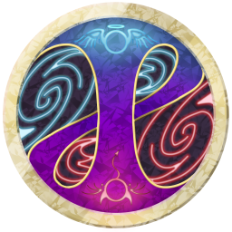
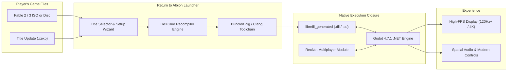

<div align="center">



# Fable: Return to Albion

**A modern, native PC and Android remake of Fable II and Fable III**

[](https://discord.gg/8UFM6p7UdR)
[](#cross-platform-matrix)
[](https://godotengine.org)
[](#prerequisites)
[](#prerequisites)
[](#prerequisites)
[](https://github.com/rexglue/rexglue-sdk)
[](#licensing)

[](https://github.com/Fable2Recomp/Fable-Return-to-Albion/actions/workflows/linux-x86_64.yml)
[](https://github.com/Fable2Recomp/Fable-Return-to-Albion/actions/workflows/linux-arm64.yml)
[](https://github.com/Fable2Recomp/Fable-Return-to-Albion/actions/workflows/windows-x86_64.yml)
[](https://github.com/Fable2Recomp/Fable-Return-to-Albion/actions/workflows/windows-arm64.yml)
[](https://github.com/Fable2Recomp/Fable-Return-to-Albion/releases)

<p align="center">
  <a href="#about-the-project">About</a> •
  <a href="#key-features">Key Features</a> •
  <a href="#multi-title-support">Supported Titles</a> •
  <a href="#quick-start-players">Quick Start</a> •
  <a href="#building-from-source-developers">Building From Source</a> •
  <a href="#build-settings--developer-ergonomics">Build Settings</a> •
  <a href="#contributing">Contributing</a>
</p>

</div>

---

## About the Project

**Fable: Return to Albion** is an ambitious, native source-level remake and static recompilation project bringing Lionhead Studios' beloved Albion chronicles—**Fable II** and **Fable III**—to modern PCs (Windows and Linux) and mobile devices (Android ARM64).

This is **not an emulator**. The original Xbox 360 PowerPC game code is decompiled and statically recompiled into native machine instructions via the [ReXGlue](https://github.com/rexglue/rexglue-sdk) recompiler SDK. The underlying simulation—quests, character progression, AI behaviour trees, physics, and world state—executes natively at hardware speed with cycle-accurate logic. 

Everything surrounding the simulation is built completely anew inside **Godot 4.7.1 (.NET)**:
- High-fidelity scene-referred HDR rendering pipeline with custom shaders.
- Decoupled framerate supporting high-refresh monitors.
- Native support for Ultrawide (21:9) and Super Ultrawide (32:9) monitors.
- Modernized user interface, menus, accessibility settings, and gamepad/keyboard-and-mouse mapping.
- Low-latency local and online co-op powered by the Rust-based **RexNet** netplay engine.
- A fully integrated, hot-reloading modding architecture.



> [!IMPORTANT]
> **Legal Disclaimer & Asset Boundary**:
> **Return to Albion contains and distributes zero game assets or proprietary code.** Players must provide their own legitimately acquired copies of Fable II or Fable III and their corresponding Title Updates. The launcher verifies, extracts, and compiles the game code locally on your hardware.

---

## Key Features

- ⚡ **Native Hardware Performance**: Uncapped framerates, zero emulation overhead, and high-DPI native resolution rendering without blur or temporal artifacts.
- 🎨 **Modernized Lighting & Visuals**: Scene-referred HDR rendering, physically based materials (PBR), dynamic daytime/weather lighting sets, volumetric fog, dynamic sky, and advanced water simulation.
- 🗡️ **Two Legendary Games in One Engine**:
  - **Fable II**: Complete game simulation, photo mode, Murgo's mirror, pub games, local 2-player co-op, and RexNet online multiplayer.
  - **Fable III**: Multi-title architecture with isolated guest memory, world entity simulations, and unified launcher support.
- 🎮 **Co-op Multiplayer**:
  - **Local Co-op**: Simultaneous two-controller split/shared-screen gameplay.
  - **Online Co-op**: Peer-to-peer online sessions orchestrated by the custom Rust **RexNet** networking library.
- 📱 **Android ARM64 Port**: Play the full experience on modern Android devices (Snapdragon 855+ / Android 12+) with customizable touch controls or Bluetooth Xbox/PlayStation controllers.
- 🛠️ **Next-Gen Modding SDK**:
  - Native `.f2mod` packaging format with automatic conflict detection and archetype inheritance.
  - GDB Title Update patch compositors (`.gdb.tu`) and Babel localization overlays (`.babel.csv`).
  - Runtime hot-reloading for code hooks, assets, and shaders.

---

## Multi-Title Support

| Title | Supported Version / Media ID | Title Update Requirement | Status |
| :--- | :--- | :--- | :--- |
| **Fable II (GOTY / Standard)** | `716F0A0D` (USA / Europe)<br>`05FBECEA` (Russia)<br>`1358B1A4` (France) | `TU_16L61VH_0000038000000.000000000008Q`<br>`TU_16L61VH_0000044000000.0000000000091`<br>*(or standalone `default.xexp`)* | **Fully Playable** |
| **Fable III** | `4D5308D6` / `0299632C` | Title Update 1 / 2 | **In Active Development** |

*Support for additional regional pressings and language versions is actively expanding.*

---

## Quick Start (Players)

1. Download the latest release archive (`Fable Return to Albion-<platform>-<arch>.zip`) from the [Releases](https://github.com/Fable2Recomp/Fable-Return-to-Albion/releases) tab.
2. Extract the archive into a folder of your choice.
3. Launch `Fable Return to Albion.exe` (Windows) or `./Fable Return to Albion.x86_64` (Linux).
4. Select your preferred game (**Fable II** or **Fable III**).
5. Point the installer wizard to your dumped game disc image (`.iso`) and title update (`default.xexp` or TU package).
6. Click **Install & Recompile** — the launcher will automatically extract assets, verify integrity, run code generation, and compile your native game payload.
7. Click **Launch Game** and enjoy Albion!

---

## Building From Source (Developers)

### Prerequisites

| Tool | Version Requirement | Purpose |
| :--- | :--- | :--- |
| **Clang / LLVM** | `20.0+` (`clang` & `clang++`) | Compiling native C++ engine libraries and ReXGlue core |
| **CMake** | `3.25+` | Cross-platform build system configuration |
| **Ninja** | `1.11+` | High-speed multi-threaded build executor |
| **.NET SDK** | `8.0+` | Building the Godot launcher and test suite |
| **Rust Toolchain** | `1.88+` (`cargo` and `rustc`) | Building the `rexnet-core` multiplayer module |
| **Git** | `2.30+` | Source control and recursive submodules |

> [!NOTE]
> All other tools—including the pinned **Godot 4.7.1 (.NET)** engine binary, export templates, and the **Zig 0.16** toolchain—are automatically fetched, checksummed, and cached into `tools/` upon first run.

### 1. Clone the Repository

Clone recursively to fetch the ReXGlue SDK and third-party dependencies:

```bash
git clone --recursive https://github.com/Fable2Recomp/Fable-Return-to-Albion.git
cd Fable-Return-to-Albion
```

*If you already cloned without `--recursive`, initialize submodules with:*
```bash
git submodule update --init --recursive
```

### 2. Configure with CMake Presets

Choose the preset corresponding to your target platform:

#### Windows (x86_64)
```powershell
cmake --preset win-amd64-debug-netplay
```

#### Linux (x86_64)
```bash
cmake --preset linux-amd64-debug-netplay
```

#### Available Presets:
- `win-amd64-{debug,release,relwithdebinfo}-netplay`
- `win-arm64-{debug,release,relwithdebinfo}-netplay`
- `linux-amd64-{debug,release,relwithdebinfo}-netplay`
- `linux-arm64-{debug,release,relwithdebinfo}-netplay`

### 3. Build & Package

```bash
cmake --build --preset win-amd64-debug-netplay
```

By default, building a preset automatically compiles native libraries, stages the Godot runtime closure into `Godot/build/x86_64/`, runs automated unit tests, and packages the final distributable zip into `out/package/`.

---

## Build Settings & Developer Ergonomics

Refii includes a content-addressed incremental build cache engine (`tools/build_cache`) designed for rapid sub-second iteration. You can customize the build using CMake cache variables and environment flags:

### Fast Iteration CMake Flags

| CMake Variable | Default | Purpose & Recommended Usage |
| :--- | :--- | :--- |
| `-DREFII_PACKAGE=OFF` | `ON` | **Speeds up iteration from ~15m to ~4s.** Skips Godot release export and zip packaging. Useful when actively editing C++ hooks or engine hostbridge code. |
| `-DREFII_STAGE_GODOT_BUILD=ON` | `ON` | Automatically stages built native `.dll` / `.so` libraries directly into `Godot/build/<arch>/bin` so the Godot Editor or Launcher picks them up immediately. |
| `-DREFII_CHECK_SHADERS=ON` | `OFF` | Compiles and validates all `.gdshader` files during the build to catch graphics regression errors early. |
| `-DREFII_BUILD_TRACY_CAPTURE=ON` | `OFF` | Builds the standalone `tracy-capture` CLI utility for in-depth CPU/GPU timeline profiling. |
| `-DREFII_DEV_SKIP_GAMECODE_REBUILD=ON` | `OFF` | Dev instrument: Allows the launcher to reuse a pre-built developer game payload directly without requiring fresh in-engine recompilation. |

### Environment Variables & Cache Controls

| Environment Variable | Description |
| :--- | :--- |
| `REFII_NO_BUILD_CACHE=1` | Disables the content-addressed test and packaging cache, forcing a completely fresh export, staging, and zip cycle. |
| `REFII_FORCE_TESTS=1` | Forces all unit and feature tests to execute, bypassing cached test pass stamps even when source inputs have not changed. |
| `REFII_NO_TESTS=1` | Rapid prototyping bypass: skips running GdUnit4 automated tests during MSBuild (`dotnet build Godot/refii-launcher.csproj -p:REFII_NO_TESTS=1`) and, set in the environment, before packaging. The automated GitHub builds set it; local builds leave it unset and run the tests. |

### Automated Testing

Automated testing is enforced across C# and C++ with strict zero-warning policies (`-warnaserror`):

```powershell
# Run the complete automated test suite (2,460+ tests)
dotnet test Godot/

# Build launcher and run tests through the test cache
dotnet build Godot/refii-launcher.csproj -warnaserror
```

---

## Discord Presence

When running, the game automatically integrates with Discord Rich Presence to display your active title (**Fable 2: Return to Albion** or **Fable 3: Return to Albion**) along with your current region (e.g., *Bowerstone Market*, *Oakfield*, or *Brightwall*).

To disable Discord Rich Presence, set:
```toml
discord_presence = false
```
in your `refii.toml` or `config.cfg`.

---

## Contributing

We welcome contributions from developers, modders, and reverse engineers of all skill levels! Whether you're interested in shader programming, PowerPC decompilation, UI styling, gameplay recreation, or documentation, there is plenty to explore.

1. **Fork & Branch**: Create a feature branch for your work (`git checkout -b feature/my-enhancement`).
2. **Follow Coding Standards**:
   - C# code follows modern idiomatic .NET 8 (NativeAOT-compatible, zero-allocation hot paths).
   - C++ code adheres to C++23 standards with Clang formatting.
   - All tests must pass with 0 warnings (`-warnaserror`).
3. **Submit a Pull Request**: Provide a clear description of your changes and test coverage.

Join our community on [Discord](https://discord.gg/zVVtGbEsCR) to discuss development, reverse engineering findings, and upcoming releases!

---

## Licensing

- **Refii Engine & Launcher**: Licensed under the [MIT License](LICENSE).
- **ReXGlue & PPC Disassembler**: ReXGlue SDK incorporates the GNU binutils PowerPC disassembler licensed under **GPL-2.0-or-later**.
- **Third-Party Notices**: Complete license acknowledgments for Godot, SDL3, Tracy, and other bundled libraries can be found in `THIRD_PARTY_NOTICES.txt`.
